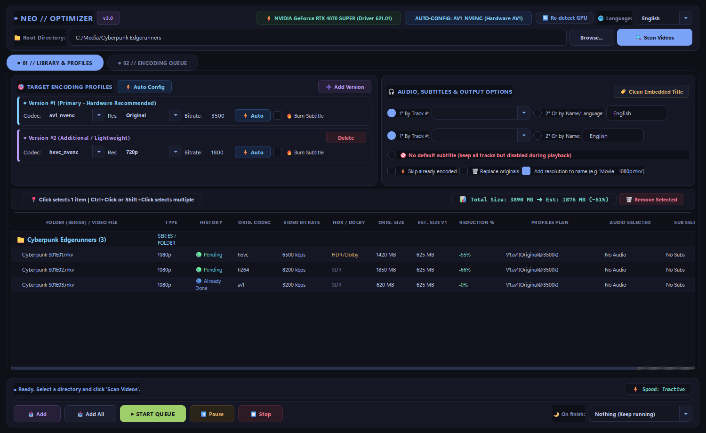
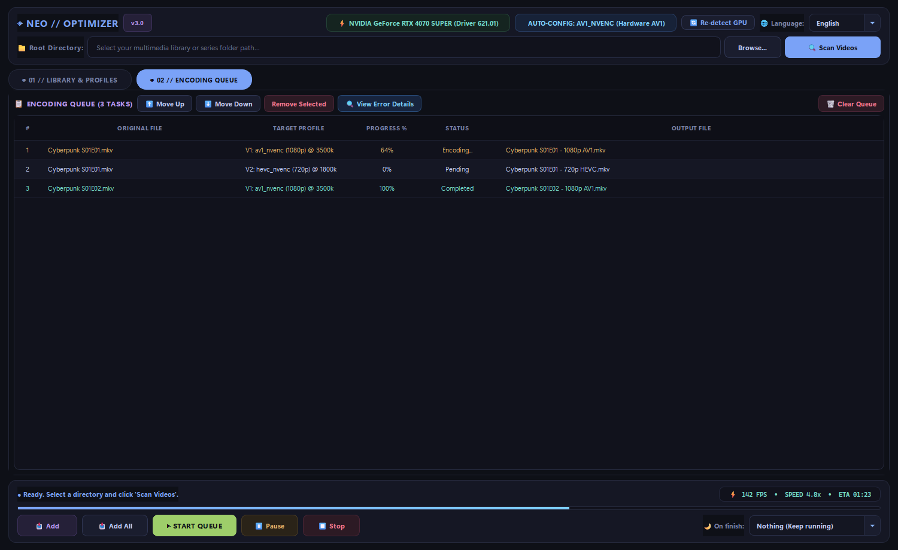

# ◈ NEO OPTIMIZER // Universal Video Optimization Suite
### Suite de Transcodificación y Optimización de Video Profesional (PyQt6 Rice Edition)

Suite de transcodificación de ultra-alto rendimiento y arquitectura moderna diseñada para bibliotecas multimedia y streaming local. Desarrollada en **PyQt6 (C++)** para un rendimiento instantáneo y redimensionamiento sin retrasos, con una interfaz ricing inspirada directamente en los mejores escritorios de **`r/unixporn`** (Tokyo Night / Catppuccin Mocha Obsidian), detección dinámica de GPU y soporte multi-idioma (Inglés, Español, Francés, Japonés).

---

## 📸 Screenshots

### ◈ 01 // Library & Target Profiles

### ◈ 02 // Encoding Queue & Live Telemetry

---

## ⚡ Características Principales

### 1. Estética Auténtica de r/unixporn (Tokyo Night / Catppuccin Mocha)
- **Workspace Pill Tabs:** Pestañas estilo Waybar/Hyprland (`◈ 01 // LIBRARY & PROFILES` y `◈ 02 // ENCODING QUEUE`) en cápsulas flotantes que sustituyen por completo el aspecto anticuado de pestañas de navegador.
- **Paleta Obsidian:** Fondo mate ultra-profundo (`#0e1017`), islas flotantes (`#151724`), bordes de 1px (`#24283b`) y acentos pastel de alta gama:
  - Zafiro / Cian: `#7aa2f7` / `#7dcfff`
  - Lavanda / Malva: `#bb9af7`
  - Menta Esmeralda: `#9ece6a` / `#73daca`
  - Ámbar Melocotón: `#e0af68` / `#ff9e64`
  - Rosa Carmesí: `#f7768e`
- **Tablas TUI sin cuadrícula (Btop/Lazygit style):** Sin rejillas de hoja de cálculo. Filas alternadas suaves, altura de fila de 32px con respiración visual, resaltado en azul noche y columnas sin truncamiento.

### 2. Detección Dinámica de GPU & Modo Auto Inteligente
- Al iniciar, detecta automáticamente la GPU del usuario:
  - **NVIDIA RTX Serie 40 (4090, 4080, 4070 SUPER, 4060, etc.)**: Detección de codificador de 8ª generación NVENC AV1 y configuración automática a `av1_nvenc`.
  - **NVIDIA RTX 30 / 20 / GTX**: Selección automática del mejor códec soportado (`hevc_nvenc` H.265).
  - **Intel Arc (QSV) / AMD Radeon (AMF) / CPU (SVT-AV1, libx265)**.
- **Botón `⚡ Auto` por perfil y global:** Calcula de forma inteligente el bitrate con calidad equivalente al origen (por ejemplo, 6000 kbps H.264 ➔ ~3000 kbps AV1 manteniendo la misma fidelidad visual).

### 3. Aislamiento Anti-Indexado para Servidores Multimedia (Jellyfin / Plex)
- Durante la codificación, los archivos en progreso usan la extensión temporal `.neo_tmp` con el formato matroska forzado (`-f matroska`). Jellyfin o Plex nunca detectarán el archivo como un episodio incompleto o corrupto hasta que la codificación haya finalizado con éxito.
- Al terminar, se renombra instantáneamente o reemplaza al original según la opción elegida.

### 4. Soporte Internacional (i18n)
- Idioma por defecto en **Inglés**, con conmutación dinámica instantánea a **Español**, **Francés** y **Japonés**.
- Adapta automáticamente las opciones de búsqueda de pistas de subtítulos y audio según el idioma seleccionado.

### 5. Acciones al Finalizar
- *Nada*, *Apagar PC*, *Hibernar*, *Suspender* o *Cerrar programa* con cuenta regresiva de 30 segundos y confirmación audible.

---

## 📦 Ejecutables y Código Fuente

| Archivo | Descripción |
| :--- | :--- |
| `dist\NeoOptimizer.exe` | **Ejecutable standalone portable** de 64-bit para Windows (sin dependencias). |
| `gui_app.py` | Código fuente de la interfaz gráfica PyQt6. |
| `core_engine.py` | Motor de análisis FFprobe, cálculo de bitrate, limpieza de metadatos y generación de comandos FFmpeg. |
| `hardware_detector.py` | Detector de GPU y compatibilidad AV1/HEVC. |
| `translations.py` | Diccionario multilenguaje dinámico. |
| `compilar_exe.bat` | Script automatizado para compilar `dist\NeoOptimizer.exe` con PyInstaller. |
| `subir_a_github.bat` | Script automatizado para sincronizar commits con GitHub. |
